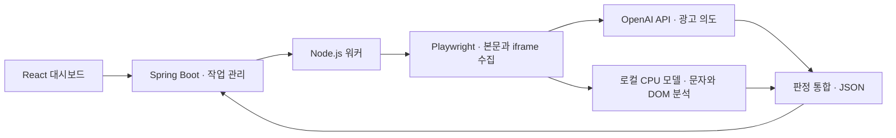

# 바른누리 · Bareun-Nuri

**공공 웹사이트의 불법광고 의심 문구와 위장 기법을 찾아 근거를 남기는 검사 도구**

## 프로젝트 소개

공공 웹사이트의 게시글과 댓글에서 의심 광고를 검토할 수 있도록 원문과 URL, 요소 위치, 탐지 기법을 수집합니다. 같은 문구가 실제 홍보인지 안내문 속 인용인지 구별하는 데 문맥을 사용하고, 글자 위장과 시각적 은닉은 별도의 로컬 분석 경로에서 확인합니다.

## 주요 기능

| 사용자 흐름 | 구현 |
| --- | --- |
| 검사 시작 | 입력 URL을 기준으로 동일 출처 링크를 탐색하고, 방문 페이지의 게시글·댓글과 접근 가능한 iframe을 검사합니다. |
| 결과 확인 | 닮은꼴 문자(HOMOGLYPH), 자모 분해(JAMO), 투명 텍스트(TRANSPARENT), 화면 밖 은닉(OFFSCREEN)을 원문·위치와 함께 표시합니다. |
| 일시 중지·재개 | 25분 구간으로 검사하고 완료된 판정과 탐색 상태를 저장합니다. 대기·제외·미판정 항목도 확인할 수 있습니다. |
| 결과 저장 | 검사 이력을 조회하고, 검토할 결과를 JSON으로 내보냅니다. |

## 아키텍처



| 영역 | 기술과 코드 위치 |
| --- | --- |
| 대시보드 | React, TypeScript, Ant Design, Recharts · [frontend](frontend/) |
| 작업 API | Java 21, Spring Boot, Maven · [backend](backend/) |
| 수집·판정 | Node.js, Playwright/Chromium, OpenAI Responses API · [agent/src](agent/src/) |
| 로컬 추론 | Python 3.12, CPU PyTorch, KcELECTRA AntiSpoof · [추론 코드](agent/antispoof/) · [모델](agent/models/kcelectra-antispoof-v1/) |

## 핵심 구현

1. **광고 의도와 위장 기법에 서로 다른 근거를 사용합니다.** 광고 여부는 대상 문구와 연결된 문맥을 함께 전달해 모델에 묻고, 응답 형식을 검증합니다. 문자 기법에는 Unicode와 로컬 모델을, 시각적 기법에는 DOM·계산된 스타일·좌표를 사용합니다. [광고 판정](agent/src/core/judgment.cjs) · [기법 분석](agent/src/core/techniques.cjs)
2. **중단된 검사를 저장된 상태에서 이어갑니다.** 방문할 페이지와 판정 진행 상황을 체크포인트에 기록합니다. 재개 시 완료 판정을 재사용하며 전송 여부가 불명확한 요청은 자동 재호출 대상에서 제외합니다. [구간 검사](agent/src/core/bounded-scan.cjs) · [체크포인트 저장](agent/src/core/bounded-scan-store.cjs)
3. **결과에서 확인할 위치와 검사 범위를 드러냅니다.** JSON은 URL·요소 위치·탐지 기법 조합별로 결과를 기록합니다. 대시보드에서 원문과 검사 종료 사유, 미처리 항목을 볼 수 있습니다. [결과 생성](agent/src/core/output.cjs) · [대시보드](frontend/src/App.tsx)

## 실행 및 검증

**화면 미리보기**는 Node.js 24로 실행할 수 있습니다. 가상 사례의 탐지 상세, 일시 중지·재개, JSON 저장을 확인할 수 있습니다.

```powershell
$env:GIT_LFS_SKIP_SMUDGE = '1'
git clone https://github.com/Hyunhoim/Bareun-Nuri.git
Remove-Item Env:GIT_LFS_SKIP_SMUDGE
cd Bareun-Nuri
npm.cmd ci --prefix frontend
npm.cmd run dev --prefix frontend
```

[대시보드 데모](http://127.0.0.1:5173/?demo=1)를 엽니다. 이 단계에서는 대용량 추론 모델의 다운로드를 건너뜁니다.

**실제 검사**는 Windows 11 x64, Git LFS, Node.js 24, Python 3.12와 `gpt-6-luna` 호출 권한이 있는 OpenAI API 키가 필요합니다. [개발 가이드](README_DEVELOPMENT.md#소스에서-실행)에 따라 LFS 모델, CPU 추론 환경과 Chromium을 준비한 뒤 `.\start.cmd`를 실행합니다. [로컬 대시보드](http://127.0.0.1:8766)에서 키를 등록하면 검사할 수 있습니다. 광고 의도 분석에는 수집한 원문과 관련 문맥이 API에 전송됩니다.

```powershell
npm.cmd test --prefix agent
```

테스트는 모델 파일 무결성, 출력 계약, 브라우저 수집, 자모 처리 등을 검사합니다. 정상 검사 결과 원본은 `.runtime/jobs/<작업 ID>/artifacts/result.json`에 저장됩니다.

## 구현 범위

검사는 공개 페이지와 접근 가능한 iframe을 대상으로 합니다. 부분 결과에는 수집·판정이 완료된 범위와 대기·누락 내역이 함께 표시됩니다. 탐지 항목은 원문을 근거로 검토할 단서입니다.

[사용설명서](docs/사용설명서.md) · [설치·테스트·Windows 패키징](README_DEVELOPMENT.md) · [제출 검증 기록](docs/최종_감사.md)
