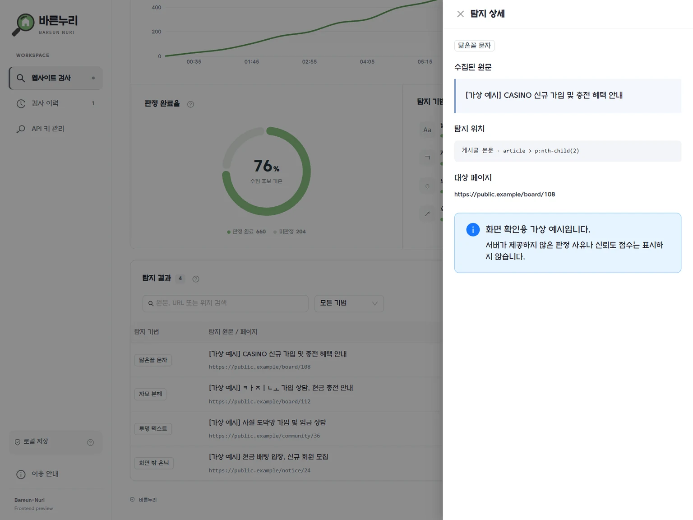
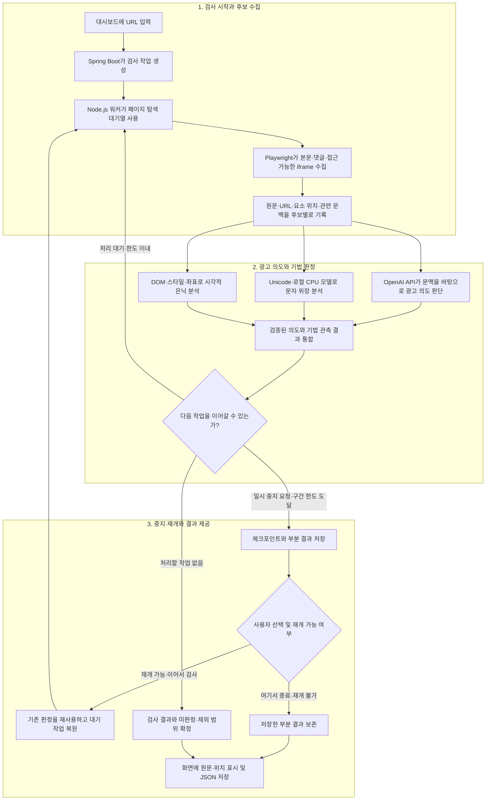

<h1> 바른누리 · Bareun-Nuri</h1>

## Overview

바른누리는 **공공 웹사이트의 불법광고 의심 문구를 찾아 검토할 근거를 남기는 도구**입니다. 게시글과 댓글을 수집하고, 광고 의도와 문구를 숨기는 기법을 분석해 원문·URL·요소 위치와 함께 보여줍니다.

## Features & Demo

### 의심 문구 수집과 탐지 상세

Playwright로 동일 출처 링크와 접근 가능한 iframe을 탐색합니다. OpenAI API는 원문과 주변 문맥을 읽어 광고 의도를 판단합니다. 로컬 모델과 문자·DOM 분석은 닮은꼴 문자, 자모 분해, 투명 텍스트, 화면 밖 은닉을 확인합니다.



*로컬 대시보드의 화면 데모. 가상 데이터로 탐지 결과를 열어 원문과 위치를 확인하는 흐름입니다.*

### 검사 중지·재개와 결과 내보내기

25분 단위로 검사를 진행하고 작업 상태와 완료된 판정을 저장합니다. 대시보드에서 중단된 검사를 재개하고, 대기·제외·미판정 항목과 탐지 결과를 확인합니다. 결과는 JSON으로 내보낼 수 있습니다.

## Architecture



사용자가 일시 중지한 검사는 같은 구간의 남은 시간으로 재개합니다. 25분이 지나 저장된 검사는 새 구간을 시작하며, 전송 여부가 불명확한 요청은 자동 재호출하지 않습니다. [검사·일시 중지·재개](docs/사용설명서.md#3-검사일시-중지재개)

## Tech Stack

| 영역 | 기술 |
| --- | --- |
| 대시보드 | React, TypeScript, Ant Design, Recharts |
| 작업 API | Java 21, Spring Boot, Maven |
| 웹 수집·의도 분석 | Node.js, Playwright, Chromium, OpenAI Responses API |
| 문자 위장 분석 | Python 3.12, CPU PyTorch, KcELECTRA AntiSpoof |

## How to Run

화면 데모는 Node.js 24로 실행합니다. 이 단계에서는 대용량 모델 가중치를 내려받을 필요가 없습니다.

```powershell
$env:GIT_LFS_SKIP_SMUDGE = '1'
git clone https://github.com/Hyunhoim/Bareun-Nuri.git
Remove-Item Env:GIT_LFS_SKIP_SMUDGE
cd Bareun-Nuri
npm.cmd ci --prefix frontend
npm.cmd run dev --prefix frontend
```

[대시보드 데모](http://127.0.0.1:5173/?demo=1)에서 검사를 시작하고 탐지 항목을 선택해 상세를 엽니다.

실제 검사는 Windows 11 x64, Git LFS, Python 3.12, `gpt-6-luna` 호출 권한이 있는 OpenAI API 키가 필요합니다. [개발 가이드](README_DEVELOPMENT.md#소스에서-실행)에 따라 모델과 Chromium을 준비하고 `.\start.cmd`를 실행합니다. [실제 검사 화면](http://127.0.0.1:8766)에서 키를 등록합니다.

## Appendix

### 제출 전 내부 테스트

2026년 10월 8일 개발 장비에서 수행한 최종 감사 기록입니다.

| 검증 항목 | 확인 결과 |
| --- | --- |
| 모델 파일·추론 | 매니페스트 자산 7개의 해시 일치, 포함된 CPU 환경에서 AntiSpoof 추론과 JSON 응답 확인 |
| 웹 수집·출력 | 로컬 테스트 페이지 수집, 원문 보존, 기법별 결과와 UTF-8 출력 확인 |
| Windows 실행기 | EXE로 백엔드 시작, 화면 HTTP 200 응답, 실행기와 백엔드 종료 확인 |
| 소스 재빌드 | TypeScript·Vite·Maven 빌드와 C# 실행기 컴파일 성공 |

이 검증은 실행·배포 구조를 확인한 기록입니다. 외부 모델 API 호출과 탐지 정확도 재측정은 검증 범위에서 제외했습니다.

[최종 감사 보고서](docs/최종_감사.md) · [사용설명서](docs/사용설명서.md) · [검증 명령과 패키징](README_DEVELOPMENT.md)
