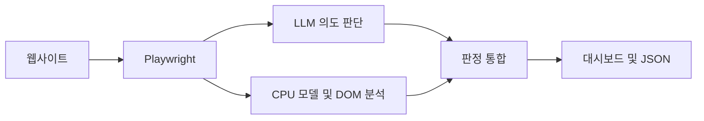

# 바른누리 · Bareun-Nuri

**공공 웹사이트 불법광고 탐지 AI Agent**

      

[Overview](#overview) · [Features](#features) · [Architecture](#architecture) · [Documentation](#documentation)

---

## Overview

LLM 문맥 판단과 CPU 파인튜닝 모델, DOM 분석을 결합한 하이브리드 탐지 시스템입니다.

## Features

- 웹 페이지 및 iframe 탐색
- 광고 의도와 4종 위장·은닉 기법 분리 판정
- 검사 대시보드, JSON 출력, 중단·재개, Windows 패키징

## Architecture

## Tech Stack

OpenAI · PyTorch · KcELECTRA · Playwright · React · Spring Boot · Node.js

## Project Status

2026-10-08 최종 감사 기준 소스 보관본. 완전한 탐지나 사이트 전체 탐색을 보장하지 않습니다.

## Documentation

[사용설명서](docs/사용설명서.md) · [최종 감사](docs/최종_감사.md)

- [상세 개발·실행 안내 및 기존 README](README_DEVELOPMENT.md)
